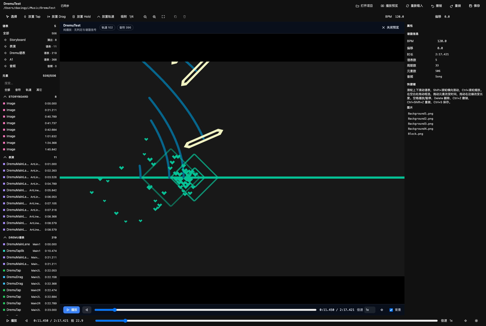

# Dremu 谱面工坊 · Dremu Chart Studio

一个 DeepSeek Harness bundle：为 Harness Web UI 增加**面向 Gorge / Dremu `.g` 谱面工程的全页制谱器**，并提供一组 Host 工具，让 agent 也能读取、编辑、生成和打包同一份谱面。

编辑逻辑与布局参考 [rpe-next](https://github.com/kclg-YSJ/rpe-next)（Re:PhiEdit Next，一个 Phigros 制谱器）：横向时间轴加吸附节拍网格、直接操作、按目录字段渲染的属性检视器、停靠式且与节拍对齐的曲线面板、撤销/重做，以及音频播放。谱面格式为本机 Dremu 谱面工程使用的 Gorge 框架声明式 `.g` 格式（`~/Music/DremuTest`、`~/Music/Chart/**`）。

> 界面语言：中文（可在插件配置里切换到 English）。

---

## 功能

* **打开谱面工程文件夹** — 解析目录下每个 `.g` 谱表文件，把各乐段铺平到同一条绝对时间轴上；素材（WAV/MP3/PNG）通过支持 HTTP Range 的接口提供给页面，音频可以拖动定位并播放。
* **新建工程** — 顶栏的**新建项目 / New project**（空页面与「打开项目」对话框里也有）会要求填写文件夹名、已存在的父目录（默认 `projectRoot`）、起始模板（空白谱面，或谱面 + storyboard）与初始乐段长度。Host 立刻写出 `DremuStaff.g`（storyboard 模板再加 `Storyboard.g`），所以新工程打开即干净、下一次保存就已经有真实目录。已存在的**空**目录会被直接采用；非空目录则拒绝，绝不覆盖。agent 侧走的是同一个流程：`gorge_project_create`。
* **按谱表分组（谱表）** — 时间轴左侧栏与元素列表都按谱表分组：每个 `.g` 谱表一个表头（`表演 · DremuStaff`、`Storyboard · DeentyStoryboardStaff`……），带轨道/文件计数，轨道名缩进在下面。点表头可折叠或展开该谱表的行。行内不再重复谱表名。
* **从左侧列表添加谱表与元素** — 谱表旁的 **+** 新建 chart 或 storyboard 的 `@ElementStaff`（表头 + 一个空 `@Chart` 乐段，下次保存时写入新的 `.g`）；元素旁的 **+** 打开元素目录，把选中的类型插入播放头位置、且落在当前选中的谱表里——轨道会取唯一名字，storyboard 图片默认取工程里的第一张图。新建的谱表可撤销（撤销会把 `.g` 再次删掉），agent 也能用 `addStaff` op 做同样的事。
* **音频乐段** — 音频谱表（`@AudioStaff`）保存一个或多个 `@Song` clip；它谱表行上的 **+** 打开对话框追加一个：挑一个工程内的音频文件，或从本机导入（文件会被拷进工程目录），设定谱面开始时间，然后保存。每条 clip 在时间轴上有一行可拖动，波形按各自偏移画在波形条里，播放时所有 clip 一起走（预览共用这套多 clip 走带）。拖 clip 的条可改时间；左侧列表可定位到某条 clip，也可移除它（音频文件留在磁盘上）。agent 用 `addAudioPeriod` / `patchAudioPeriod` / `removeAudioPeriod` 编辑，重命名走 `patchAudioPeriod`。工程还没有音频谱表时，谱表表头的音频按钮会连同第一条 clip 一起创建 `Song.g`。
* **右键谱表可重命名或删除** — 每个谱表行上的右键菜单可改它的别名（`.g` 头的 `displayName`，一步可撤销的 `setStaffName` op），或删除该谱表。删除会先确认，然后从磁盘移除 `.g` 和它的 `.bak`（`removeStaff` 配 `deleteFile`）；此操作永久且不可撤销。
* **时间轴编辑** — 每个轨道名（`DremuMainLane`、`DremuGuideLane`）一行；一行显示所有带该名字的 lane 元素（谱面会跨乐段复用名字：`DremuStaff2.g` 有 82 个 lane 元素、33 个名字），以及它的音符（`DremuTap`、`DremuDrag`、`DremuHold`、`DremuTaplik`）、hold 主体与内层音符刻度；storyboard 图片与未知元素类型各有自己的行，不会丢失。
* **直接操作** — 拖动元素改时间，拖右边缘改 `keepTime` / `holdTime`，框选，⇧+点击扩展选区，在空白处双击用当前工具放置。
* **判定线音符编辑器** — 双击轨道条（选择工具下）或它的槽/标签，打开该轨道的竖向编辑器：横向是 note 的 `position`（0.5 列网格），纵向是 `hitTime`（按工程 BPM/offset 的节拍网格），底部一条固定判定线（未来在它上方），最左边缘是音频频谱。`Q` / `W` / `E` / `R` 选择 Tap / Drag / Taplik / Hold，点击放置（Hold 可拖出长度）；拖动音符改时间与位置，拖 Hold 尾部改长度，框选/删除，方向键微调，或在检视器里编辑选中的音符。放置工具激活时点轨道条标签也能进入编辑器；每个手势是一步撤销；顶栏返回按钮 / `Esc` 回到时间轴，且不丢失视图。
* **属性检视器** — 选中元素的每个字段都按目录渲染（数字、字符串、布尔、枚举、`VariableFloat`、`Vector2`、`ColorArgb`、函数曲线、`FunctionPiece` 数组，以及目录未描述的「其它字段」原始编辑区）。
* **嵌套值** — 检视器/曲线侧栏里的对象卡片使用 72px 的紧凑标签列（外层元素行仍是 104px），这样嵌套两三层深的 `Vector2`、`ColorArgb` 仍有可用的数字/颜色输入，而不是被挤成一条缝。
* **可选字段** — 每个可选目录字段都有复选框：`VariableFloat` 的 `variationCurve`（位置 X/Y、旋转 Z、绘制区间……）、音符与轨道的 `color` / `respondHintColor1/2`、`LerpColorCurve.colorPoints` 与 `progressCurve`，以及可选的 `FunctionPiece.functionCurve`。勾上会写入目录默认值（新曲线是一条平零的 `LinearCurve`），取消勾选则移除该字段——嵌套字段从父对象消失、顶层字段从元素字段表消失，`.g` 文件回到省略形式。
* **停靠曲线面板** — 检视器的曲线按钮在中间面板（时间轴区域）打开一个全尺寸分段编辑器，同时顶栏、工具栏、左右侧栏与走带仍然可用。X 轴是曲线自身的相对秒数；节拍刻度与吸附跟随主时间轴的 BPM/offset 和工具栏的吸附细分，原点为选中元素的开始时间。面板停靠在**时间轴内容下方**、中间面板的下半部：标尺/行/波形仍在上面可见，曲线编辑器占据剩余高度（时间轴取测量出的内容高度并最多占 58%，编辑器至少保留 42%）。x 视图与主时间轴**实时同步**：使用主时间轴当前的 `t0`/每秒像素和同样的 148px 时间槽，所以节拍线与上方主标尺垂直对齐；滚动或缩放主时间轴会带动面板，面板上的横向滚轮/平移/缩放也驱动主时间轴，两者始终处于同一 `t0`/pps。面板的时间标签相对元素；**fit** 按钮适配整个工程时间轴（两个视图一起），reset 只重置曲线。数组里的曲线（`laneLines` 等）同样有曲线按钮，不限于顶层字段。普通函数曲线以**一个合成段**打开并保留自身类型；新增第二段或拖动段边界会把它转换为 `PiecewiseFunctionCurve`。右键绘图区可**新建段 / 修改函数类型 / 删除段**（类型从函数列表里选）；段边界可以拖动（始终共享，因此不会出现空隙或重叠），选中的段会暴露可按类型拖拽的参数——常量值、`kx+b` 控制点、`LinearCurve` 关键帧、样条端点/切线、周期/轴对称引导与内层曲线。面板是上下堆叠的：绘图区/标尺/段条占满宽度的上半部，下方**属性**区放段列表、类型选择、边界/标志、完整数值编辑器与数值跳变警告（太高时滚动）。数值跳变警告卡片带一个**自动修复**按钮：把右段整体上下平移，让共享边界处与左侧一致（复合或未知曲线会被包进带常量偏移的 Addition），段边界时间与外侧 ±∞ 边界保持不动；确认草稿后再 Apply。一次 Apply = 一步撤销；未做改动的 Apply 会原样写回原值。
* **自动 BPM** — 检视器的 BPM 行有**自动 BPM**按钮。它从缓存的频谱推出低频加权的谱通量起音包络，在 60–200 BPM 上跑 Goertzel 节奏谱（含谐波支持与轻度速度先验），结果通过 `setMeta.tempo` 写入，节拍网格与走带立即更新。之后 BPM 字段仍可编辑。
* **波形 / 频谱视图** — 右键轨道上方的音频条，可在每条 clip 的**波形**与**频谱图**之间切换（对数频率热力图，用 1024 点 STFT、最高 8192 × 128 分辨率从各 clip 采样计算，并按文件缓存）。选择会记在 `localStorage`。
* **播放** — 每条音频 clip 一条波形带、播放/暂停、定位、速率（0.25×–2×）、跟随播放自动滚动。
* **播放预览（autoplay / 仅播放）** — 顶栏的预览按钮把 Dremu 演出场景的 16:10 Canvas-2D 渲染嵌**在时间轴面板**（`.dgc-center`）里；编辑器顶栏、左侧列表与检视器仍然可见。它从 Unity 形态渲染器移植而来：判定线来自 `laneLines` + `animation`，音符与 hold 主体来自各自的 `distance` / `position` 曲线，配有 `LerpColorCurve` 颜色、16:10 的相机取景、autoplay 观感（命中瞬间音符头消失），以及 `DremuRespondHint` 菱形/爱心判定特效与 `RespondEffect.wav`。仅播放——没有信号、判定、计分、HUD，也没有 hold 的 `innerNotes`。`Space` 播放/暂停，`Esc` 关闭，`←` / `→` 定位。移植后的模型写在 `docs/playback-model.md`。

  
* **撤销/重做、复制/粘贴、重复、微调** — 所有编辑都排成 op 批次，因此每个手势恰好是一步撤销。
* **保存真实的 `.g` 文件** — 原子写入；会话内首次保存时把原内容写成 `.g.bak`。编解码是字节精确的：打开后不做改动直接保存，每个文件逐字节一致。
* **导出可分享的谱面包（导出 ZIP）** — 顶栏按钮把**当前实时文档**打包成 `<project>.zip`，因此不必先保存就包含未保存的改动。压缩包里是一个 `<project>/` 文件夹，含每个 `.g` 谱表、`README.md`，以及谱面真正引用的音频/图片（会解析 storyboard 的 `image:<name>` 引用与 `@Song` 的 clip 路径）；未被引用的文件只报告为跳过，不给包体增肥。浏览器带进度读数把它流式下载到下载目录；`gorge_chart_export` 为 agent 做同样的事，并把 zip 写在工程旁边。
* **Agent 工具** — 同一份文档暴露为 `gorge_project_list` / `gorge_project_open` / `gorge_project_create` / `gorge_chart_get` / `gorge_chart_edit` / `gorge_chart_save` / `gorge_chart_export` / `gorge_chart_validate` / `gorge_element_schema`，并向系统上下文注入一行工作区摘要。agent 的改动会实时出现在打开的编辑器里。
* **内置 agent 技能** — `dremu-chart-editing` 随 bundle 一起提供，并注册到 Harness 的 `skills` 服务：何时使用、绝对时间与乐段相对时间的规则、类型化值树与 patch 路径、元素语义、常见错误，以及可直接复制的 op 批次（`skills/dremu-chart-editing/SKILL.md` + `references/`）。它和其它技能一样通过 `skill` 工具加载，Host 启用本 bundle 启动后即可见。

## 安装

bundle 就在本目录。在具备完全访问权限的 Harness 会话里：

```
plugin_manager { action: "install_bundle", target: "<本检出目录的路径>" }
```

安装会把该检出链接进来，因此之后在本目录的修改刷新页面即生效（替换 JavaScript 模块需要重启，任何 bundle 都一样）。特别是新建工程、添加/导入音频乐段与 ZIP 导出需要**新的 Host 半边**：升级本 bundle 后请退出并重开应用，再使用「新建项目」「音频」「导出」按钮。插件在**设置 → 插件**里显示为“Dremu 谱面工坊”，也出现在侧栏面板列表（金色轨道字形）；点击即在中栏打开制谱器。

## 使用

1. 点击侧栏字形。要从零开始就点**新建项目**：填文件夹名、已存在的父目录（预填 `projectRoot`）、起始模板（空白谱面或谱面 + storyboard）与初始长度；Host 写出 `.g` 文件并打开工程。要打开已有谱面，点**打开项目** → 选一个文件夹（`~/Music/DremuTest`、`~/Music/Chart/Chart 2`……）或直接输入绝对路径。库列表从配置的 `projectRoot` 扫描（默认 `~/Music`）。
2. 点谱表旁的 **+** 新建谱表，点音频谱表行上的 **+** 追加一个音频乐段，或点元素旁的 **+** 选类型并插入到播放头；左侧列表立即更新。
3. 在工具栏选工具（或 `V` 选择、`Q` tap、`W` drag、`E` hold、`T` lane），设定吸附细分，然后双击时间轴放置。要逐个编辑某条判定线上的音符，选中轨道条并双击它（或双击该轨道的槽/标签）打开音符编辑器；`Esc` 或「返回时间轴」返回。
4. 选中元素后在右侧检视器里编辑；可选字段（例如 `VariableFloat` 的 `variationCurve`）用复选框启用，曲线字段的曲线按钮会在中间面板打开停靠曲线面板（Apply/取消后回到时间轴）。
5. `Ctrl/Cmd+S` 保存。默认开启自动保存（插件配置里的 `autoSave`），防抖后走同一个原子写入器。
6. 点顶栏的**导出 ZIP** 把当前谱面下载为 `<project>.zip` 包。无需先保存：谱表文件来自实时文档，被引用的素材与 `README.md` 一并拷入，toast 会报告文件名、大小，以及跳过了多少未引用素材。
7. 点顶栏的**播放预览**：Autoplay 演出场景（音频 + canvas）替换时间轴面板，编辑器顶栏与侧栏仍然可见。`Space` 播放/暂停，`Esc` 关闭；canvas 下方的预览条有重播、定位、速率、静音和 storyboard 背景开关。

### 快捷键

| 键 | 动作 |
|---|---|
| `V` / `Q` / `W` / `E` / `T` | 选择 / tap / drag / hold / lane 工具 |
| `Space` | 播放 / 暂停 |
| `Delete` / `Backspace` | 删除选区 |
| `Ctrl/Cmd+Z`、`Ctrl/Cmd+Shift+Z` / `Ctrl+Y` | 撤销 / 重做 |
| `Ctrl/Cmd+S` | 保存 |
| `Ctrl/Cmd+A` | 全选元素 |
| `Ctrl/Cmd+C` / `Ctrl/Cmd+V` | 复制 / 粘贴到播放头 |
| `Ctrl/Cmd+D` | 重复（+1 网格步长） |
| `←` / `→` | 选区微调一个网格步长（无选区时定位） |
| `1`…`8` | 吸附细分 1/1 … 1/16 拍 |
| `+` / `-` / `0` | 放大 / 缩小 / 适配 |
| `Home` | 回到 0:00 |
| `Esc` | 清空选区 / 切回选择工具 |
| `Space` / `Esc`（播放预览） | 播放/暂停，关闭预览 |
| `←` / `→`（播放预览） | 向后 / 向前定位 |
| `Q` / `W` / `E` / `R`（音符编辑器） | Tap / Drag / Taplik / Hold 工具 |
| `↑` / `↓`（音符编辑器） | 选中音符在时间上微调（Shift ×4） |
| `←` / `→`（音符编辑器） | 选中音符在位置上微调（Shift ×2） |
| `+` / `-` / `0`（音符编辑器） | 放大 / 缩小 / 重置 |
| `Esc`（音符编辑器） | 先清空选区，再关闭编辑器 |

鼠标：滚轮滚轨道行，`Shift`+滚轮滚时间，`Ctrl`+滚轮以指针为中心缩放，中键拖动或 `Alt`+拖动平移，在标尺上拖动定位。音符编辑器里：滚轮定位，`Ctrl`+滚轮缩放，点击频谱/标尺定位，`Alt` 临时关闭吸附，拖动 Hold 尾部改长度。双击轨道条（选择工具下，或任意模式下它的标签/槽）打开音符编辑器。右键谱表行（或元素列表里的谱表分组表头）可重命名别名或删除。

## 插件配置

在 profile 的 `cordis.patch.yml` 里、插件行的 `config:` 块中设置键（`dsh plugin --profile desktop` 管理该文件）。loader 通过 `Config['~standard'].validate` 校验该行；本插件故意**没有设置面板**（它的 `Config` 不能冒充 Schemastery schema —— 一个 `toJSON()` 仿制品会让 `settings/describe` 崩溃，并以 `desktop welcome: Web RPC failed` 中止桌面端启动）。

| 键 | 默认值 | 含义 |
|---|---|---|
| `projectRoot` | `~/Music` | 扫描谱面工程的文件夹（含 `*.g` 的目录） |
| `autoSave` | `true` | 把编辑防抖写盘；`false` 时改动留在 Host 直到显式保存 |
| `locale` | `zh` | Host 半边的显示语言提示 |

## 架构

```
package.json          bundle 清单（dsh.bundle.patch + dsh.client）
cordis.patch.yml      插入 loader 行
index.js              Host 半边：工程 store、HTTP/SSE、agent 工具、提示词上下文
gorge-codec.js        .g 文本 <-> 类型化值树，字节精确写入器（无 I/O）
dremu-model.js        谱面模型：目录、工程创建/加载/保存、时间、op 应用
gorge-zip.js          谱面包导出：无依赖 ZIP 写入器 + 素材选择
skills.js             注册到 ctx.skills 的内置技能 provider
skills/dremu-chart-editing/  agent 技能：SKILL.md + references（工具/op、
                      元素字段、配方）
client.js             浏览器半边：整个编辑器 UI（一个自包含文件）
locale/{zh,en}.json   显示元数据
docs/                 gorge-format-spec.md（.g 文本格式）、
                      playback-model.md（Unity → Canvas 播放移植）、
                      note-editor.md（判定线音符编辑器几何与 op）
tests/                codec / model / host / skill / client 冒烟测试（纯 node 脚本）
```

`client.js` 保持单文件，因为 bundle loader 每个包只提供一个 client 模块。它按编号分节（`// 07 · Audio`、`// 15 · Timeline canvas`、`// 15.5 · Judgement-line note editor`……）。`index.js`、`dremu-model.js` 与 `gorge-codec.js` 遵循同一约定——编号分节横幅加文件头的分节索引——所以每个文件顶部的注释就告诉你该跳到哪。

数据流：浏览器保留一份乐观副本。一个手势变成一个 op 批次（`patch` / `add` / `remove` / `setMeta` / …），本地应用后以 `{baseRev, ops}` POST 到 `/plugins/gorge-chart/edit`；Host 把它应用到权威模型、递增修订号、自动保存并通知 SSE 订阅者。当修订号并非本标签页产生（agent 编辑）时，页面重新拉取 `/state`。`.g` 序列化始终在 Host 完成。`GET /export` 复用这个实时模型：序列化每个谱表（含未保存改动）、从工程目录打包被引用的素材并返回一个 ZIP，因此下载与 agent 工具共用同一个打包器。

## 格式说明

一个谱表文件就是一段很小的声明式程序：

```
[
    string form = "Dremu",
    string displayName = "Dremu谱表"
]
@ElementStaff
class DremuStaff
{
    [
        PeriodConfig^ config = PeriodConfig : {
            timeOffset : 0.0,
        }
    ]
    @Chart
    static Element^[] Period()
    {
        return new Element^[1]{
            DremuTap : {
                laneName : "mainLine01",
                hitTime : 2.842105,
            },
        };
    }
}
```

* 一个类可以声明多个乐段方法（`Period`、`Period1`……）；每个都有自己的 `timeOffset`（绝对开始秒数），其中的元素时间相对该偏移。编辑器会把它们铺平。
* 值是类型化对象/列表字面量（`Type : {...}` / `Type^ : {...}`）、枚举引用、数字、字符串，偶尔还有 `(-1.0/0.0)` ±无穷 表达式。
* 写入器是规范的，且与 `~/Music/DremuTest` 和 `~/Music/Chart/**` 的整个语料逐字节一致（见 `tests/codec.test.mjs`）。

## 开发

```
node tests/codec.test.mjs        # 12/12 语料文件逐字节一致 + 37 项 codec 检查
node tests/model.test.mjs        # 71 项：加载/保存保真（CRLF + LF）、创建、op、音频乐段、目录
node tests/host.test.mjs         # 43 项：store、创建/打开、HTTP handler、导出 ZIP、音频导入、工具、Range、恢复
node tests/skill.test.mjs        # 15 项：技能文档、示例、provider、注册
node tests/client-smoke.mjs      # 在极简 React 运行时里挂载页面（fixture 工程）
GORGE_SMOKE_REAL=1 node tests/client-smoke.mjs
                                 # ……再对真实 DremuTest 工程跑一遍
node tests/fixtures/review-undo-repro.mjs
                                 # 带 React-18 批处理语义的回归测试
```

客户端测试夹具是一个刻意做小的 React 兼容运行时（函数组件、带真实依赖记忆化的 hooks、refs、宿主元素），外加 bundle 用到的浏览器全局。它断言页面能渲染、时间轴能绘制、选中元素会填满检视器、停靠曲线面板能打开并 Apply、右键建段/改类型/删段与拖动边界会发出预期的分段 patch、客户端曲线采样器与 Host 的 `evaluateCurve` 一致、拖动音符发出 `patch(hitTime)`、撤销发出反操作、重做恢复、放置一个 Tap 发出带该行轨道的 `add` op。判定线音符编辑器同样端到端跑过：双击轨道条（以及标签/槽快捷入口）能打开它，canvas 会绘制频谱标题、判定线标签与节拍数字，`Q`/`W`/`E`/`R` 用吸附后的 `hitTime`/`position`/`holdTime` 创建四种音符，拖动音符会同时 patch 时间与位置，拖 Hold 尾部会 patch `holdTime`，框选删除发出 `remove` ops，在频谱上拖动定位会保持按下时刻的锚点（因此拖动定位时播放头不会滑走），`Esc`/返回按钮回到时间轴。新建工程流程也端到端挂载：顶栏按钮打开对话框并预填 `projectRoot`，非法名字原地报错且不发请求，选 storyboard 模板与自定义长度后把 `{ name, parent, template, minLength }` POST 到 `POST /create`，应答后的状态关闭对话框、显示成功提示并采用新工程。

## 验证状态

* **Host 半边在本 profile 中已生效**（`plugin_manager` 报告 bundle 已启用；`application: applied`）。Host 侧改动（新的创建/音频 op 以及 `/create`、`/import-audio`、`/export` 路由）在下次 Host 启动时生效；client 半边刷新页面即加载。已从 shell 通过 HTTP 验证：`/state` 返回目录，`/projects` 列出 6 个谱面文件夹，`/create` 写出并打开起始工程，`/edit` 能往返，`/file` 支持 Range 请求，`/export` 流出的 zip 被 `unzip -t` 判为有效。
* **新建工程由 Node 与 client 套件覆盖**：`validateProjectName` 拒绝分隔符、隐藏名/尾点号与过长名字；`create: ...` 写出 `DremuStaff.g`（可选还有 `Storyboard.g`），采用已存在的空目录，对非空目录返回 409，并对失败的空目录回滚；HTTP handler 应答 200/400/409，agent 工具能创建、打开并立刻编辑工程；client 冒烟测试覆盖对话框、原地校验、POST body 与采用后的状态。
* **音频乐段由 Node 套件覆盖**：`addAudioPeriod` 写出第二个 `@Song`（保存 → 重载后两个 clip 与 32 秒时长都还在），外部文件按唯一的工程内相对名拷贝，patch/remove 往返，自动创建 `Song.g` 可行，HTTP 导入端点仅限本地请求、仅音频扩展名且请求体有上限。
* **谱面包导出由 Node 与 client 套件覆盖**：`gorge-zip.js` 通过一个中央目录读取器往返，校验两个头部、UTF-8 文件名标志与每个 CRC；包里带着未保存的谱表改动、被引用的 storyboard 图片与 `@Song` 音频、README，且从不带 `.bak`；`assets=all|none` 都生效；HTTP handler 以 `application/zip` 加下载头应答；页面冒烟测试把响应变成一个带 Host 提供名字的 `download` 链接并给出成功提示。
* **Agent 工具已实地验证**：`gorge_project_open` 打开了 `~/Music/DremuTest`（5 个谱表 / 506 个元素 / 137.421 秒），`gorge_chart_get` 返回铺平后的谱面，`gorge_chart_validate` 返回 0 个问题。
* **内置技能已注册且可加载**：`tests/host.test.mjs` 断言 `apply` 注册了 `gorge-chart` provider（一个 `dremu-chart-editing` 候选，rank 600）并能 dispose；`tests/skill.test.mjs` 解析技能、检查每个引用链接/JSON 示例，并跑 `list` / `get` / 注册。在本开发检出里，同一技能还链接进 gitignore 的 `.dsh/skills/` 工程根，所以线上会话的目录与 `skill` 工具无需重启就验证过；下次 Host 启动时由 provider 路径接管。
* **语料安全**：codec 与 model 套件把真实工程拷到临时目录；只读语料在前后各取一次哈希，断言未被改动。
* **播放预览由 client 冒烟套件做结构性断言**：`node tests/client-smoke.mjs` 与 `GORGE_SMOKE_REAL=1 node tests/client-smoke.mjs` 会检查预览模型与帧采样器（轨道 / 音符 / hold / 颜色，在 fixture 工程与真实 `DremuTest` 工程上）、引导轨道节点变换，以及预览挂载在 **`.dgc-center` 内部**、能绘制并关闭。
* **播放预览做过肉眼校验**，用无头 Chrome 对着真实页面代码 + `DremuTest`（在多个谱面时刻截图，26 秒附近的 hold、11 秒附近的引导/特效场景）：音符贴图、轨道/引导线朝向、hold 主体、storyboard 背景、判定菱形/爱心与镜头缩放，都对照 Dremu 实机参考视频比过。参考视频是**另一份**谱面（`enchanted love`），所以它验证的是语义而非像素一致；要逐帧对齐需要那份谱面的 `.g` 工程。
* **轨道/hold 几何与 Godot 适配器做过交叉验证**，跑的是同一份 `DremuTest` 谱面：在 t=4.352 秒（动画 ArtLine）与 t=26.20 秒（hold）处，轨道/hold 的位置与形状现在一致。这次交叉验证找出并修好了两个真实的曲线 bug：带权 `CubicHermiteSpline` 切线没有按 y 跨度归一化（drawStart/End 冲出范围），以及用 `expr Infinity` 的 `PiecewiseFunctionCurve` 边界被跳过（holdLine 尾巴丢失）。那次运行没有 `DeentyStoryboard` 与九宫格扩展，所以只比较了轨道/hold/爱心；`DremuRespondHint` 圆环使用与 Godot 适配器 `draw_gorge_nine_slice` 相同的 Gorge 九宫格算法。
* **打击音**是形态里的 `RespondEffect.wav`（播放时每次命中播一次，随歌曲静音）；无头 Chrome 统计了 `Audio.play()` 调用次数（一段密集区域 4.5 秒内 13 次打击音）。
* **停靠曲线面板由 client 冒烟套件覆盖**：面板渲染在 `.dgc-center` 内；普通曲线显示一个合成段，未改动的 Apply 原样往返；右键 + 选类型会建出连续的第二段；侧栏类型选择器让单段保持普通类型；拖动边界会改它的时间并把普通曲线转成分段；删除一段会把它的跨度转给邻居；纯函数辅助器（`__curve`）对照 Host 的 `evaluateCurve` 断言分段开区间边界、轴对称/周期默认值、Addition 字段名、平坦样条与复合求值。fixture 与 `GORGE_SMOKE_REAL=1` 两种模式都通过。
* **可选字段也被覆盖**：勾上缺失的可选颜色会加目录默认值，取消勾选通过整字段 patch 移除该字段；勾上某个 tap 的 `VariableFloat.variationCurve` 会加一条平零 `LinearCurve`、保留 `baseValue`、暴露曲线按钮，编辑它（`valueEnd` 0.5）会精确 patch `[position, fields, variationCurve]`，重新打开面板仍是 0.5；真实 `DremuTest` 的轨道也暴露嵌套的 `variationCurve` 复选框。套件还断言曲线面板进入分栏布局（`has-curve`）、曲线层是时间轴之后的常规流子节点（不是绝对定位覆盖层）、时间轴内容高度传入 `--dgc-timeline-h`、对齐视图在 148px 时间槽 / 每秒 46px 下把相对 x=0 与 x=1 放在主标尺对应的 x 位置、缩放主工具栏会重绘面板节拍网格且恢复后网格也恢复、滚动面板绘图区会改变共享视图且滚回来能复原、以及数组内的曲线以 item 路径（`['curves','items',0]`）打开。自动修复辅助器在两段、多边界级联与复合三种情况下断言（复合会被包成加常量偏移）；UI 测试把常量改成 999、点警告卡片上的自动修复、Apply，然后检查边界采样值相接。
* **编辑器页面**仍由 `tests/client-smoke.mjs` 做结构性检验；刷新 Web UI 并点侧栏字形可确认布局/主题。

无依赖、无构建步骤：client 半边是模块加载器格式的纯浏览器 JavaScript，只从 Harness 模块表里导入 `react`。样式使用 `--dsw-alias-*` 主题 token，所以页面跟随外壳的浅色与深色主题。

## 已知限制

* 播放预览实现的是 Autoplay 的**谱面层**（轨道、音符、hold、storyboard、`DremuRespondHint` 菱形/爱心与 `RespondEffect.wav`），但不含游戏的 **UI 层**（分数/连击/判定 HUD/暂停菜单）与 Unity 的 bloom/shader pass。它是视觉预览，不是可玩版本。
* 判定线音符编辑器是一个聚焦的一维视图：它用 `VariableFloat.baseValue` 摆放音符（`variationCurve` 在检视器里可编辑，但不在 canvas 上预览），未来画在底部固定判定线上方，位置只显示 ±5.5 世界单位内。它是制谱视图，不是演出场景；要看渲染后的谱面请用播放预览。
* 时间轴是制谱器而不是游戏渲染器：它显示元素的时间范围，不是演出场景。播放预览绘制演出场景，但只是 **Canvas-2D 近似**——线帽/拐角跟随 CurveSprite 预制体（`numCapVertices=10` 圆帽、`numCornerVertices=0` 斜接拐角）；混合与 Unity 的材质/bloom pass 接近但不逐像素等同真实渲染器。`positionZ` 排序与九宫格判定圆环是精确实现的；曲线仍以数据（curve）形式编辑，并以绘图（plot）形式预览。
* 只有目录里有的元素字段才有友好标签；其它字段可在「其它字段」区编辑，但显示原始字段名。
* 曲线面板的 X 轴是曲线自身的相对秒数，不是绝对谱面时间。节拍刻度以选中元素的开始为原点，这对音符 `hitTime` / 轨道 `generateTime` 曲线是精确的，但对松手相对曲线（hold 的 `endDistance` 相对松手时间）是近似的。
* 段的**时间**连续性被强制（共享边界，无空隙/重叠）；**数值**跳变只会被标记（绘图区上的 `!` + 侧栏列表），从不自动平滑。复合曲线用数值编辑（它的外层输入就是内层输出，因此没有直接的时间手柄）。
* `.g.bak` 备份写在谱表文件旁边（每个文件每会话一次）。它们是纯拷贝，编辑器不会清理。
* 播放时页面会随走带时钟重渲染（左侧列表、检视器与停靠曲线面板有记忆化，时间轴通过自己的 rAF 循环绘制）。
* Host 刷新（agent 编辑、重载、冲突）会替换本地文档并清空客户端撤销栈：磁盘上的文档才是权威。音频乐段编辑在批次之后会重新拉取权威 clip 元数据，同时保留自己的撤销项。
* 播放预览只做播放：没有谱面信号、判定、计分、连击/HUD，也没有 hold 的 `innerNotes`。`DremuRespondHint` 菱形/爱心判定特效与 `RespondEffect.wav` 已实现；Unity 的 bloom/shader 没有。storyboard 背景支持开关后的 `DeentyStoryboard.Image`；不支持 `StoryboardVideo`。
* Host 重启时会从恢复快照重新打开上次的工程；`autoSave` 为 `false` 时，已接受但未保存的 op 批次会被重放。
* ZIP 导出只盘点工程顶层文件（和编辑器的素材列表一样）。子目录里被引用的素材，或只在未知元素类型里被提到的素材，不会被自动识别；要整目录拷贝请用 `gorge_chart_export { assets: "all" }`（或 `/plugins/gorge-chart/export?assets=all`）。
