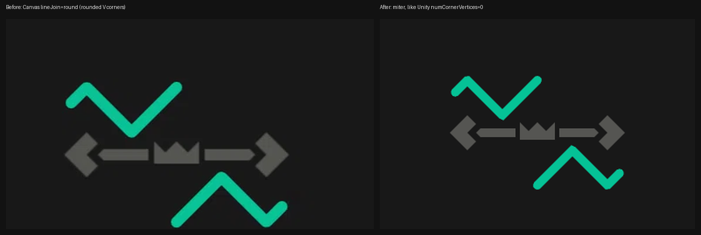
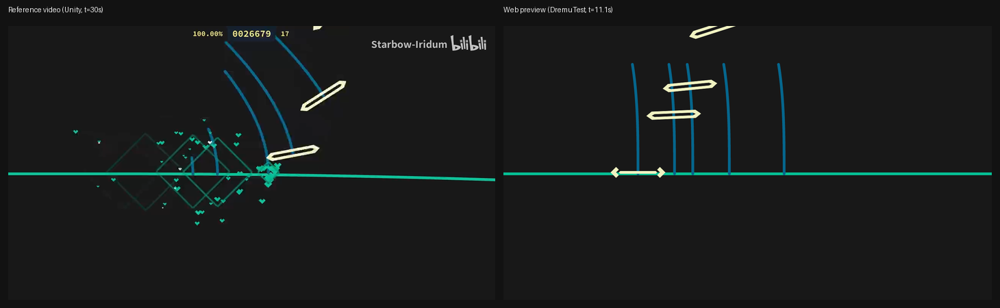
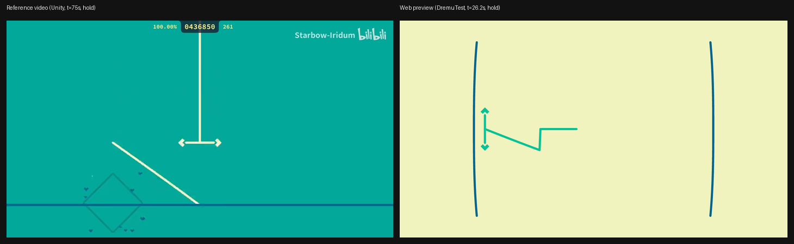
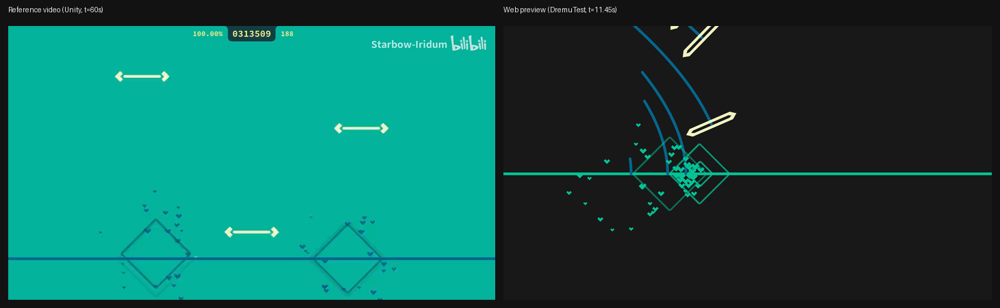
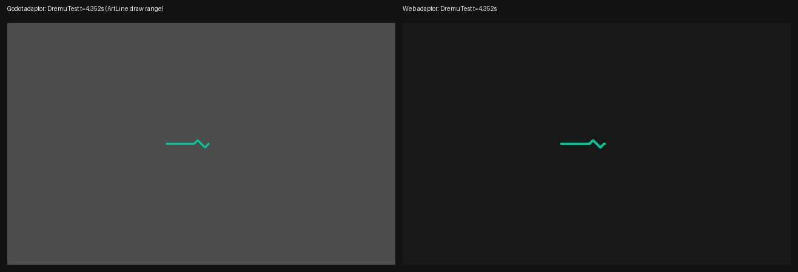
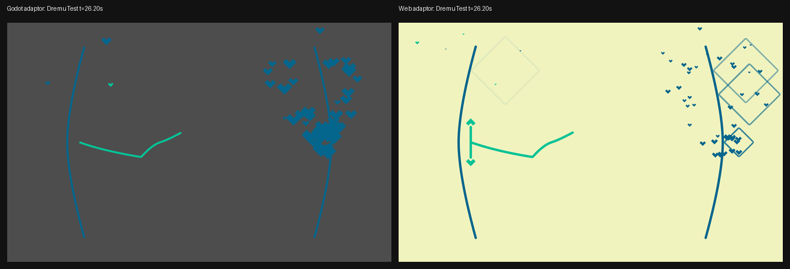

# Dremu 播放预览渲染模型（Web 移植）

> `client.js` 的 Autoplay 播放预览（纯播放）如何把 Unity GorgeStudio 的 **Dremu 模态**渲染语义
> 移植到 Canvas 2D；实现与本文冲突时先改其一。通用格式/曲线语义见 `docs/gorge-format-spec.md` §C.3–C.9、§D.1–D.3。
>
> UI 位置：预览嵌入编辑器的时间轴面板 `.dgc-center`，取景框固定 16:10 居中；不覆盖顶栏和左右栏。

只读来源：`sampleforms/Dremu/{Lane,Note}/**/*.g` 与 `Transformers/*.g`、`Note/Tsiga/AutoPlay/*.g`（状态时刻）、
`GamePlay.unity`（orthographic size 5、16:10 Base 16×10）、`CurveSprite.prefab`（线宽 0.1）、`SelfAdaptiveStandardBase.cs`（缩放 `s`）。

## 1. 范围：只播放，不模拟玩法

预览等价于 Unity 的 `isAutoPlay = true` 分支，只负责“看起来对”：

* 保留：轨道形状与关键帧动画、音符位置/旋转、长条体、颜色曲线、生命周期、叠放次序、背景图、
  打击特效 `DremuRespondHint`（菱形 + 心形粒子）与 `RespondEffect.wav`。
* 不实现：Tsiga 状态机与 `TouchSignal`（无输入图、无判定窗口）、评分/连击/HUD、长条
  `innerNotes`、Storyboard 视频；Unity 的 shader/bloom 不模拟。
* autoplay 状态只影响可见性：单键 `hitTime` 进 `Accepted`，长条 `hitTime` 进 `Holding`、`hitTime+holdTime` 进
  `Accepted`；颜色变换器把 `Accepted/Denied/Holding` 的 alpha 置 0 ⇒ **音符头在打击时刻消失**，即 autoplay 的视觉特征。

## 2. 时间模型

`.g` 内是 period 相对时间，绝对时刻 = `PeriodConfig.timeOffset + local`（`@PeriodModifier`）。曲线横轴：

```
lane : t = now - generateTime
note : t = now - hitTime
hold : s = now - hitTime - holdTime
image: p = useChartTime ? now - startMoment : (now - startMoment) / keepTime
```

## 3. 坐标系与相机

Unity：正交 `orthographic size 5`（可视高 10），清屏色 `(0.192,0.302,0.475)` = **#314D79**；`16:10 Standard Base`
的 `size = (16,10)`，内容区 `x ∈ [-8,8]`、`y ∈ [-5,5]`，原点居中、**+y 向上**。`SelfAdaptiveStandardBase` 对内容
整体等比缩放（两轴同一 `scale`），代入运行时自适应基（宽 `10*aspect`、高 10）化简：

```
s  = aspect >= 1.6 ? 1 : aspect / 1.6   // 16:10 内容缩放；窄屏等比缩小、左右铺满、上下留背景边
k  = H / 10                             // 每世界单位像素数（世界高 10）
px = W / 2 + s * k * wx
py = H / 2 - s * k * wy                 // Canvas y 向下，取反
```

`aspect = W / H`（Canvas 绘制尺寸，与 ctx 坐标系一致）；z 只用于叠放（§11），不参与透视。

## 4. 模型构建（`buildPlaybackModel`）

输入 Host 的 wire project，输出可 JSON 序列化的纯数据场景模型：

* 轨道按 `name` 分组（`DremuMainLane` 主判定线 / `DremuGuideLane` 引导线），同名可跨 period 多次出现，
  绑定时取**生成时刻存活**的那个（音符看 `hitTime - leadTime`，引导线看自身 `generateTime`，多人存活取最新）；
  音符按 `laneName` 绑轨，顺序同 `DremuNote`：先主轨道、再引导轨道。
* 找不到存活轨道时 Unity 音符构造函数返回 null、永不生成 ⇒ **未绑定音符只统计不绘制**；`innerNotes`/
  `respondHintColor`/`hintReference` 读入不绘制；背景图取 `DeentyStoryboard.Image`，采样前按 §9 窗口剪枝。

## 5. 轨道几何

```
// 形状：laneLines 多关键帧按 animation 进度插值（默认 LinearFunctionCurve{k:1,b:0} → t）
progress = animation.Evaluate(t) ; i1 = clamp(floor(progress),0,n-1) ; i2 = clamp(ceil(progress),0,n-1)
y(x) = i1 == i2 ? curve[i1].Evaluate(x) : lerp(curve[i1](x), curve[i2](x), progress - i1)
// 主轨道：位置/旋转 + 法线（Δ = evaluateDelta，默认 0.01）
pos(t) = (positionX.EvaluateAdd(t), positionY.EvaluateAdd(t)) ; rot(t) = rotationZ.EvaluateAdd(t)  // 度
T(x) = (2Δ, y(x+Δ) - y(x-Δ)) ; n(x) = normalize(-T.y, T.x)
P(x,d) = pos(t) + R(rot(t)) · (x + n.x*d, y(x) + n.y*d)
// 折线：drawStartX..drawEndX 采样 pointCount 点（默认 -10/10、100）
start = drawStartX.EvaluateAdd(t) ; end = drawEndX.EvaluateAdd(t)
point[i] = P(start + i*(end-start)/(pointCount-1), 0)
```

默认 `laneLines` 是单条 `ConstantFunctionCurve{value:0}`（y=0 直线），缺失/为空按 y=0；轨道线色
`color == null ? 白 : color.Evaluate(t)`（`DremuLaneColorTransformer.g`）。

**引导轨道**：`position` 沿主判定线移动，`laneLines` 把“离主线的距离”映射成“沿主线的偏移”
（记 `M(x,d) = mainLane.P(x,d)`）：

```
mainX(x,d) = x + position.EvaluateAdd(t) + laneLines.Evaluate(d)
P_guide    = M(mainX, d) ;  rot_guide = angle(P_guide(0,d+Δ) - P_guide(0,d-Δ)) - 90
fix        = targetProjectionFix ? sin(deg2rad(mainLane.normalAngle(position.EvaluateAdd(t)))) : 1
Q(x)       = M(laneLines.Evaluate(x) * fix, x)   // 引导线折线：x 即“距离”，fix 投到主判定线切线
```

音符落在**主轨道局部坐标系**（`noteReferenceNode = mainLane.positionNode`），最后乘主轨道的
`pos(t)/rot(t)`。**引导线多一层 guide node 变换**（`DremuGuideLanePositionTransformer.g`）：

```
baseX   = position.EvaluateAdd(t) ; baseY = mainLane.EvaluateLineY(baseX, t)
guideRot= angle(mainLane.normal(baseX)) - 90
line    = mainPose( (baseX,baseY) + R(guideRot) · Q(x) )     // Q(x) 为上面的主轨道局部折线
```

即引导线是穿过主轨道上 `x = position` 点、沿主法线方向的横线；它的局部点仍按 `Q(x)` 采样，再经
guide node 平移/旋转，最后才乘主轨道 `pos(t)/rot(t)`。引导线的音符不受这层变换影响（reference 是
主轨道节点）。

## 6. 音符（Tap / Drag / Taplik）

```
d = distance.Evaluate(t)        // 默认 LinearFunctionCurve{k:-8,b:0}：1.5s 前距线 12
x = position.EvaluateAdd(t)     // 默认 0
P_head   = lane.P(x, d)
rot_head = lane.rotation(x, d) - 90    // 主轨道 = normalAngle(x)-90；引导线 = 切线角-90
```

贴图 2.0 × 0.4 世界单位（白 + alpha），颜色 = `color == null ? 白 : color.Evaluate(t)`，用颜色乘白色
贴图（Unity 顶点色乘算 ≈ Canvas 离屏合成）。

## 7. Hold 长条体

头同单键（`P_head`、`rot_head`、Tap.png）。长条体是 `pointCount`（默认 100）个采样点的折线，线宽 0.1
（`DremuHoldLineTransformer.g`）：

```
waiting = 状态 == "Waiting"    // autoplay：hitTime 前 Waiting，之后 Holding，+holdTime 后 Accepted
startD  = waiting ? distance.Evaluate(now-hitTime) : (now >= hitTime ? 0 : distance.Evaluate(now-hitTime))
endD    = endDistance.Evaluate(now - hitTime - holdTime) ; dStep = (endD - startD) / (pointCount - 1)  // k=-8
startT  = waiting ? 0 : max(0, now - hitTime)
tStep   = truncation ? ((endD - startD) / holdLength * holdTime) / (pointCount - 1)
                     : (holdTime - startT) / (pointCount - 1)
mainX = position.EvaluateAdd(now - hitTime) ; fix = targetProjectionFix ? sin(deg2rad(normalAngle(mainX))) : 1
for i in 0..pointCount-1:
    x = mainX + holdLine.Evaluate(t) * fix    // holdLine 默认 ConstantFunctionCurve{0}
    point[i] = lane.P(x, d) ; d += dStep ; t += tStep
```

`hitTime` 前整段朝判定线推进；`Holding` 期间 `startD` 钉在 0、`endD` 随释放逼近 0，长条体缩回线；
到 `hitTime + holdTime` 转 `Accepted`、alpha 归 0。头部贴图与单键相同：`Tap.png`（`DremuHold.g`）；
`Holding` 期间头部 alpha 归 0、只保留长条体。

## 7.5 打击反馈（Autoplay 命中）

每个音符在 `hitTime` 由 autoplay 以 `BestPerfect` 调用 `DoRespond`（`DremuNote.g` / `DremuHold.g`）：
播放 `RespondA` 音效并派生一个 `DremuRespondHint`，存活 **0.8s**。

```
progress = CubicHermite(0,0 -> 1,1 ; startTangent 0, endTangent 0.1, endWeight 0.8)(age/0.8)
ringSize  = atan(progress * 0.8 * 5) * 2 * 2.5 / pi      // world units
ringAlpha = atan((1-progress) * 0.8 / 0.2) * 2 / pi
ring      = RespondHint(RespondHint.png 9-slice, baseSize 0.2, border 169px, rotation 45°, z=-1.5)
            // 绘制算法与 Godot adaptor 的 draw_gorge_nine_slice 一致（见 §11 注）
hearts[16]: 方向随机、距离 1.2..2.5、finalSize 0..0.2、keepTime 0.3..0.8
  p = CubicHermite(age/keep) ; pos = respondPos + direction*distance*p
  size = lerp(0.3, finalSize, age/keep) ; 0.225/finalSize*0.75 同式
  color = (age/keep > 0.93) ? respondHintColor2 : respondHintColor1 ; z=-1
```

`respondPos` 是命中时音符的**轨道局部坐标**（hold 用 `position + holdLine(0)*fix`、distance 0）。
`hintReference` **默认 false**：效果固定在命中时的世界位置；为 true 时随主轨道节点移动。
音效文件 `RespondEffect.wav`（0.262s，44.1kHz 立体声），Unity 用 `@InstantAudio RespondA` 播放。

## 8. 颜色

`LerpColorCurve.Evaluate(x)`（`docs/gorge-format-spec.md` §D.3）：

```
stops = colorPoints                       // ColorArgb[]，分量 a,r,g,b，缺省分量 = 1
p  = progressCurve ? progressCurve.Evaluate(x) : 0
i1 = clamp(floor(p),0,n-1) ; i2 = clamp(ceil(p),0,n-1)
color = lerp(stops[i1], stops[i2], p - i1)    // 逐分量；空 stops → 白，null progressCurve → 首色标
```

`color == null` 的轨道/音符一律**白色**（`DremuLaneColorTransformer.g`、`DremuNoteColorTransformer.g`）；
颜色含 alpha，autoplay 命中后把头 alpha 置 0。

## 8.1 曲线求值（本轮修复的两处关键 bug）

**加权 `CubicHermiteSpline`** 必须按 `GorgeFramework.CubicHermiteSpline.AnimationCurveInterpolant` 实现：

```
xdx = (x-x1)/dx ; dy = y2-y1
求 t：3(1-t)^2 t wt1 + 3(1-t)t^2 (1-wt2) + t^3 = xdx   // Householder
yp1dy = tangent1*dx/dy ; yp2dy = tangent2*dx/dy
y = 3(1-t)^2 t wt1 yp1dy + 3(1-t)t^2 (1 - wt2*yp2dy) + t^3
value = y1 + y*dy        // y1==y2 时用 tangent*dx 的特例
```

旧实现漏了 `/dy` 归一化，`startTangent=-80` 这类曲线会过冲到 -35（真实值约 -1.46），直接把判定线拉出屏幕。

**`PiecewiseFunctionCurve` 的 `startX/endX` 可以是 `expr`**（如 `special:"Infinity"`、`special:"-Infinity"`）。
这些边界必须视为 ±∞，不能当 `null` 跳过；否则 holdLine 的尾段会被整段丢弃，长条体出现平段/台阶。

## 9. 生命周期与可见窗口

```
轨道：   [generateTime, generateTime + keepTime]
音符头： [hitTime - leadTime, hitTime]              // autoplay：hit 当帧仍绘制，之后消失
长条体： [hitTime - leadTime, hitTime + holdTime)   // 头同上；体在释放时刻消失
打击反馈： [hitTime, hitTime + 0.8)               // ring；心形各自 keep 0.3–0.8
背景图： [startMoment, startMoment + keepTime]
```

`leadTime` 决定提前多久出现（默认 1.5s）。autoplay 下 `lagTime`（默认 1.5s）不再产生可见内容——头在
打击时刻消失、长条体在释放时刻消失——它只保留为元素销毁窗口；窗口重叠时同一元素只算一次。**头在打击
时刻消失**是 autoplay 的既定表现，不要为了“打击感”在命中后继续画头。

## 10. 引擎默认值（≠ CATALOG 作者默认值）

| 元素 | 默认值（字段 = 值） |
|---|---|
| `DremuLane` | `generateTime 0`、`keepTime 10`、`laneLines [Constant 0]`、`animation Linear{k:1,b:0}`、`drawStartX -10`、`drawEndX 10`、`pointCount 100`、`evaluateDelta 0.01`、`color null`、`positionZ -1` |
| `DremuMainLane` | 继承 + `positionX 0`、`positionY 0`、`rotationZ 0` |
| `DremuGuideLane` | 继承 + `mainLaneName 必填`、`position 0`、`targetProjectionFix true` |
| `DremuNote` | `laneName 必填`、`hitTime 0`、`leadTime 1.5`、`lagTime 1.5`、`position 0`、`distance Linear{k:-8,b:0}`、`color null`、`positionZ -2`、`hintReference false`、`respondHintColor1/2 null(白)` |
| `DremuHold` | 继承 + `holdTime 1`、`endDistance Linear{k:-8,b:0}`、`holdLine Constant 0`、`truncation true`、`holdLength 1`、`pointCount 100`、`targetProjectionFix true` |
| `DeentyStoryboard.Image` | `startMoment 0`、`keepTime 1`、`positionMode ScreenX`、`positionX/Y/rotationZ 0`、`scaleX/scaleY 1`、`positionZ 1`、`alpha 1`、`useChartTime false` |

⚠ **不要把 CATALOG 颜色当播放颜色**：`dremu-model.js` 的 `LANE_COLOR`/`NOTE_COLOR` 是“新建元素的作者默认值”，`@EditableElement` 的 `color` 只是编辑器元素列表的色块。

| 来源 | 轨道 | 音符 |
|---|---|---|
| `CATALOG`（`LANE_COLOR`/`NOTE_COLOR`） | `#05C296` | `#F0F2C1` |
| `@EditableElement` 显示色 | `#3DA2CC` | Tap `#05668D` / Drag `#F1F3BE` / Taplik `#03C399` / Hold `#CC3D9F` |
| **播放实际默认** | 白 `#FFFFFF`（`color` 为 null） | 白 `#FFFFFF`（`color` 为 null） |

## 11. 绘制常量与叠放次序

* 清屏（相机 clear）：**#314D79**；轨道线/长条体线宽：**0.1 世界单位** → `0.1 * s * k` 像素。
* 音符贴图 **2.0 × 0.4 世界单位**（200×40 像素 → 100px/单位，直接拉伸即 1:1）；叠放次序按
  `positionZ` **从大到小**（远→近）。`positionZ` 越小越靠前；同 z 时固定优先级：
  **背景图(0) → 轨道线(1) → 心形(2) → 菱形(3) → 长条体(4) → 音符头(5)**。

## 12. 贴图来源与再生成

* 文件：`.../sampleforms/Dremu/Dremu/FormAsset/{Tap,Drag,Taplik}.png`，**200×40 RGBA**，RGB **全白**、
  形状只在 alpha；长条头用 `Tap.png`。Unity 侧 `NineSliceSprite(texture,(80,0),(80,0),baseSize=(2,2))`
  + `size=(2,0.4)`：左右各 80px 切片、中间 40px 拉伸，默认尺寸下正好 100px/单位，故直接拉伸即 1:1。
* `client.js` 以 `data:image/png;base64,...` **内嵌**三张图（单文件、无网络依赖）；重新生成时在 `FormAsset`
  目录执行下列命令，把输出替换进 `client.js` 的 data URI：

```
node -e "const fs=require('fs');for(const n of ['Tap','Drag','Taplik'])console.log(n,'data:image/png;base64,'+fs.readFileSync(n+'.png').toString('base64'))"
```

换贴图必须保持 **200×40、纯白 RGB、alpha 携带形状**，否则上色/尺寸会漂移。

* 打击反馈资产同样内嵌：`RespondHint.png`（340×340）、`Heart.png`（40×30）与 `RespondEffect.wav`。
  菱形环用 **Gorge 九宫格原算法** 绘制（`baseSize 0.2`、四边 border 169px、`size` 1→2.5；
  算法逐行对照 Godot adaptor 的 `draw_gorge_nine_slice`），不是近似圆角方框；仅 Unity 的 bloom 不还原。

## 13. 与 Unity 的已知差异

* **已修复的曲线求值 bug**：加权 `CubicHermiteSpline` 的切线未按 y 跨度归一化（判定线 drawStart/End 过冲）；
  `PiecewiseFunctionCurve` 的 `expr Infinity` 边界被当作空值（holdLine 尾段丢失、长条体台阶）。两处均已按
  GorgeFramework 源码修正，并在同一 `DremuTest` 上与 Godot adaptor 的 4.352s / 26.20s 帧对齐。

* **LineRenderer 端帽/拐角**：Unity 是三角带（圆帽、拐角细分），Canvas 用 `lineJoin/lineCap` 近似；
  端点/尖角与线宽分布不保证像素级一致。
* **没有 shader / bloom**：材质发光、bloom、颜色空间与叠加不还原，预览整体更“平”。
* **打击反馈**：时序、尺寸、颜色、音符局部坐标按 form 数据；菱形环使用与 Unity/Godot 相同的九宫格
  数学（`baseSize 0.2`、border 169px），心形方向用 note id 播种，重放稳定但不等于 Unity 的随机序列；
  bloom 不还原。
* **屏幕适配**：Unity 适配器 `SelfAdaptiveStandardBase` 把 16:10 内容根**等比**缩放到相机并居中；
  Godot 适配器用 `x*viewportW/16, y*viewportH/10` **拉伸填满**。Web 采用 Unity 模型（视频是 Unity）；
  舞台不是 16:10 时内容会居中留边，而不是横向拉伸。
* **z 次序**：Unity/规范是 `positionZ` 越小越靠前；Godot adaptor 直接把 `positionZ` 写进 `ZIndex`
  （越大越前），两者相反。Web 采用 Unity/规范，并按 z 从大到小排序。


* **LineRenderer 端点**：Unity `CurveSprite.prefab` 是 `numCornerVertices=0`（尖角 miter） +
  `numCapVertices=10`（圆头 cap）；Web 已按此设置 `lineJoin='miter'`、`lineCap='round'`。
  注意轨道/音符的 alpha 是 form 数据（例如 t=9.296 的 Taplik 按自身 color 曲线是 27% 透明），不是渲染 bug。
* **HUD/计分不绘制**：分数、连击、判定文字、暂停菜单属于 UI 层；谱面元素与打击反馈都绘制。
* **判定线/引导线公式与 Unity 对齐**：`position/rotation`、`laneLines` 动画、`drawStartX/EndX`、线色都按
  `now - generateTime`；引导线额外经 guide node（position + 法线旋转）；z 次序按 §11。
* 上色用 Canvas 离屏合成代替顶点色乘算，视觉等价。

参考对照（左：Unity 实机视频；右：本预览，同一套 Dremu 语义、**不同谱面**）：







同一份 `DremuTest` 谱面，Godot adaptor（左）与 Web adaptor（右）在 t=26.45s 的对照。Godot 运行时缺
DeentyStoryboard/九宫格扩展，故没有背景、音符头和菱形环；主轨道/长条/心形的位置与朝向一致（Godot
窗口 viewport 1728→帧 1920 的 1.111 缩放已还原）：





* 结构验证：`client.js` 的不可枚举 `__playback` 钩子暴露 `buildPlaybackModel` / `collectFrame` / `colorCurveAt`；
  `collectFrame(model, time, opts)` 返回纯数据帧（不碰 DOM/Canvas），`tests/client-smoke.mjs`（含
  `GORGE_SMOKE_REAL=1`）可直接断言几何、引导线对齐与 0.8s 打击反馈窗口。